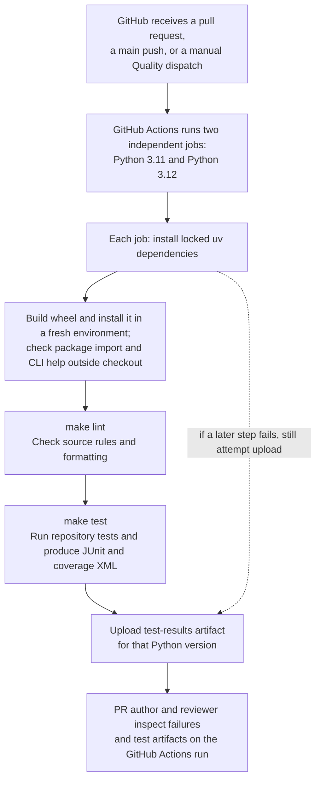
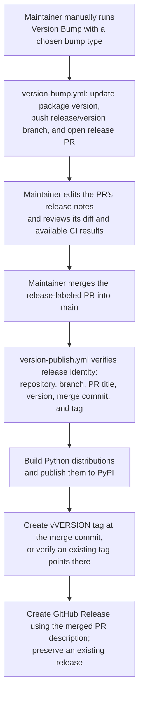

# CI and releases

[Documentation](../../README.md#documentation) · [Repository architecture](../../docs/architecture.md)

CI checks the host package. Release workflows publish Python distributions to PyPI and create a GitHub Release; they do
not publish runtime images or host-adapter bundles.

## Workflow map

| Workflow                                   | Trigger                                            | Result                                                           |
| ------------------------------------------ | -------------------------------------------------- | ---------------------------------------------------------------- |
| [Quality](quality.yml)                     | Pull request, push to `main`, or manual dispatch   | Python 3.11/3.12 checks and test/coverage artifacts              |
| [Version bump](version-bump.yml)           | Manual dispatch with a bump type                   | Version change on `release/<version>` and an editable release PR |
| [Release and publish](version-publish.yml) | Merged PR into `main` carrying the `release` label | Verified Python package publication, tag, and GitHub Release     |

## Quality checks

Arrows show the steps in each Python job. The final artifact upload uses `if: always()`, so it is also attempted when an
earlier step fails; reports may be absent if their producing step never ran. The PR author diagnoses failures, and the
reviewer checks the linked Actions results before accepting the change.



The wheel smoke test installs into a fresh environment and checks imports and CLI help outside the checkout. The
workflow installs PostgreSQL development headers and copies `.env.sample` for repository tests. JUnit and coverage
upload is attempted even after failure. Real Odoo/PostgreSQL integration tests remain opt-in.

```bash
# Reproduce the main host checks locally after configuring the project .env.
uv sync --locked
make lint
make test

# Inspect recent CI runs with GitHub CLI.
gh run list --workflow quality.yml --limit 5
```

## Create a release

The maintainer chooses and reviews the release; GitHub Actions performs the version change and publication steps. The
release notes are the PR description. They are separate from the JUnit test and coverage artifacts above.



```bash
# Maintainers: choose patch, minor, major, rc, beta, or alpha.
# This dispatch creates and pushes a release branch and opens a PR.
gh workflow run version-bump.yml --ref main -f bump_type=patch
```

Edit the generated PR description before merging: it becomes the release notes. Keep these identities aligned:

| Identity          | Required value                      |
| ----------------- | ----------------------------------- |
| Source repository | This repository                     |
| Target branch     | `main`                              |
| PR title          | `🔖 Release <version>`              |
| Source branch     | `release/<version>`                 |
| Package version   | The same version, verified by Hatch |
| Tag               | `v<version>` at the PR merge commit |

The publication workflow rejects an existing tag pointing elsewhere. It publishes to PyPI before creating the tag and
GitHub Release. Existing GitHub Releases keep their descriptions; alpha, beta, and release-candidate versions are marked
as prereleases.

If a run fails, inspect the failed step and existing PyPI/tag/release state before retrying that run. Do not move an
existing release tag to bypass a mismatch.
