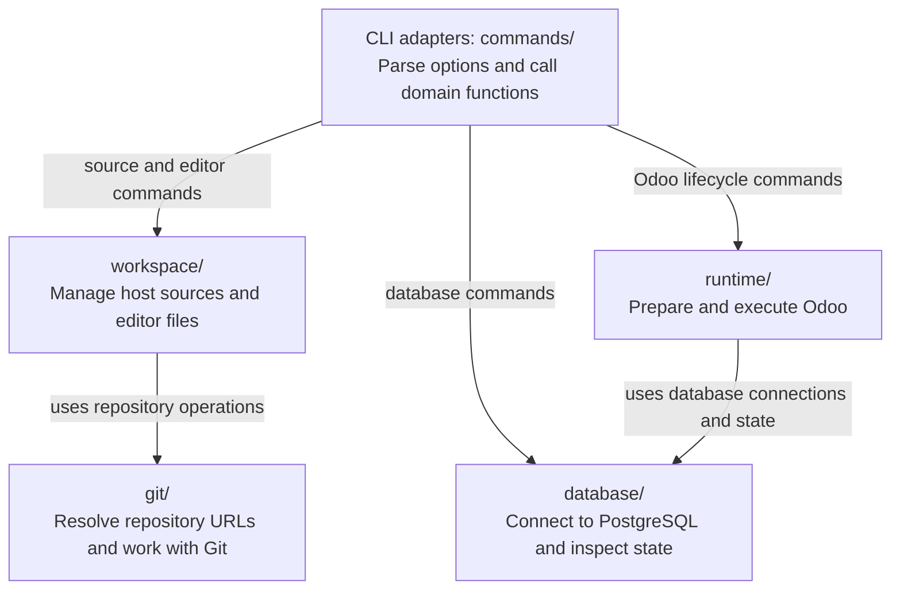

# Repository architecture

[Documentation](../README.md#documentation) · [Workspaces](workspace.md) · [Runtime](lifecycle.md) ·
[Downstream setup](downstream.md)

gOdoo separates host source management from Odoo execution. CLI adapters translate options into domain operations;
downstream projects provide the services and operating environment.

## Ownership at a glance



Arrows show code dependencies, not execution order. Shared value types and utilities support these domains. Domain
operations stay independent of CLI registration.

| Location                   | Responsibility                                                                  |
| -------------------------- | ------------------------------------------------------------------------------- |
| `src/godoo_cli/commands/`  | Public Typer commands, option metadata, and domain adapters.                    |
| `src/godoo_cli/workspace/` | Manifest selection, managed worktrees, editor state, and image materialization. |
| `src/godoo_cli/runtime/`   | Preparation and execution against an Odoo database and matching filestore.      |
| `src/godoo_cli/database/`  | PostgreSQL connections and database state.                                      |
| `src/godoo_cli/git/`       | Repository URL and Git operations used by workspace commands.                   |
| `src/godoo_cli/models/`    | Configuration value types shared across domains.                                |
| `src/godoo_cli/helpers/`   | General-purpose utilities.                                                      |
| `tests/`                   | CLI and domain tests, plus opt-in runtime integration tests.                    |
| `addons/`                  | Odoo addons and their Odoo-side tests.                                          |
| `docker/`, `config/`       | Representative downstream images, Compose services, and configuration.          |

## Where a change belongs

| Change                                               | Start here                                                                     |
| ---------------------------------------------------- | ------------------------------------------------------------------------------ |
| Add a public command                                 | Export its group in `commands/__init__.py`; register it in `commands/root.py`. |
| Add an environment-backed option                     | Reuse metadata in `commands/common.py`.                                        |
| Change source selection or generated workspace files | `workspace/` and the [workspace contract](workspace.md).                       |
| Change initialization, execution, or recovery        | `runtime/` and the [lifecycle contract](lifecycle.md).                         |
| Add project policy or a data repair                  | Downstream hooks or native Odoo migrations; see [hooks](hooks.md).             |
| Change images, mounts, users, or service ordering    | The downstream project; use [the examples](downstream.md) as a reference.      |

The host owns Git, workspace commands, VS Code, linting, and the development `.venv`. Odoo uses `VIRTUAL_ENV` when set,
otherwise the project's `.venv`. gOdoo does not detect or orchestrate containers.

## Validation layers

Run from the gOdoo checkout after configuring `.env`:

```bash
# Install the locked host dependencies and pinned text formatter.
uv sync --locked
npm ci

# Run repository checks sequentially.
make lint
make test

# Generate editor state before checking its Python typing boundary.
make workspace
make typecheck
```

| Layer                        | Establishes                                                              | Limit                                                |
| ---------------------------- | ------------------------------------------------------------------------ | ---------------------------------------------------- |
| Lint and repository tests    | Source contracts, command behavior, and unit coverage of `godoo_cli`.    | Does not establish a working Odoo deployment.        |
| Wheel smoke test in CI       | The built package imports and its CLI starts outside the checkout.       | Does not initialize Odoo.                            |
| Editor validation            | Generated paths, interpreter selection, diagnostics, and debug mappings. | Attachment also needs a running downstream debugger. |
| `make test-odoo-integration` | Real Odoo/PostgreSQL lifecycle behavior in a prepared environment.       | Runs separately from normal CI.                      |

Keep installed-package identity separate from source identity: a checkout or Dockerfile pin alone does not establish
which gOdoo revision a running image contains.
