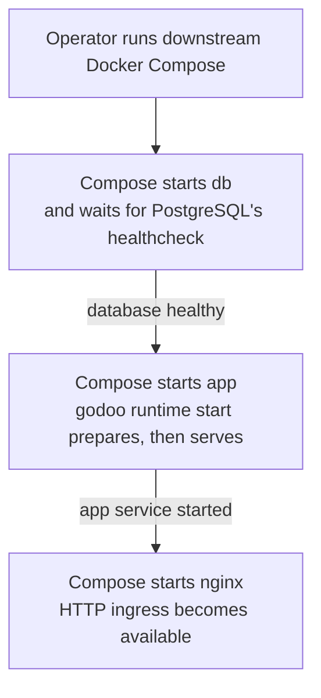
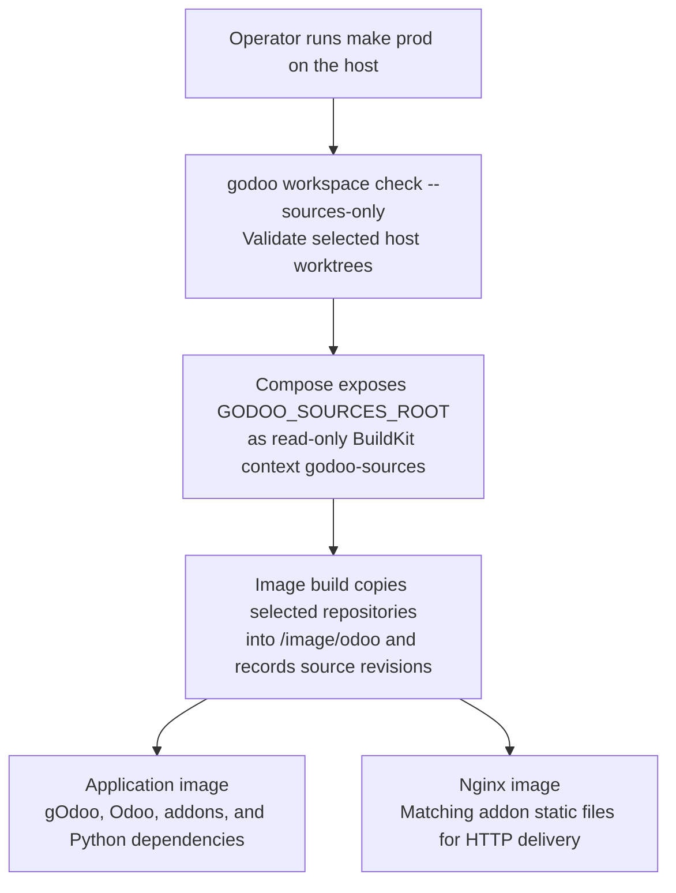

# Downstream runtime setup

[Documentation](../README.md#documentation) · [Workspaces](workspace.md) · [Lifecycle](lifecycle.md) · [Hooks](hooks.md)

Downstream projects own Dockerfiles, Compose, system packages, runtime UID/GID, mounts, secrets, service startup,
debugger startup, and images. gOdoo selects sources and prepares or runs Odoo inside that environment. The supported
database topology is a same-host PostgreSQL sidecar on an isolated Compose network.

## Service and ownership boundaries

This diagram shows **Compose startup dependencies**, not HTTP traffic. A failed database healthcheck prevents app
startup; failed preparation makes the app exit before it serves. “App service started” is a Compose state, not proof of
HTTP readiness. The [HTTP and file delivery](#http-and-file-delivery) section describes request routing.



| gOdoo owns                                         | Downstream owns                                               |
| -------------------------------------------------- | ------------------------------------------------------------- |
| Manifest selection and managed source worktrees    | Host setup and the source-root location                       |
| Editor configuration and resolved source paths     | Bind mounts and BuildKit contexts                             |
| Runtime preflight, init, launch, and pair recovery | Service ordering, users, system packages, and secrets         |
| Hook execution and native migration forwarding     | Hook contents, environment policy, and migration selection    |
| Nginx module lookup generation                     | Nginx templates, image targets, includes, mounts, and reloads |

## Prepare sources and start development

From a configured project directory:

```bash
# Host operations; sync can reset verified managed worktrees.
godoo workspace sync
godoo workspace check

# Resolve shell-safe paths before Compose evaluates its mounts and build contexts.
eval "$(godoo workspace runtime-env)"
export GODOO_SOURCES_ROOT GODOO_RUNTIME_ODOO_PATH GODOO_RUNTIME_ADDON_PATHS

# Use the representative development overlay with its base file.
docker compose -f docker/docker-compose.base.yml \
  -f docker/docker-compose.dev.yml up --build
```

`GODOO_SOURCES_ROOT` must be absolute and outside the project. The development overlay mounts the project read-write and
the entire source root read-only at its existing absolute path. `GODOO_RUNTIME_ODOO_PATH` selects Odoo;
`GODOO_RUNTIME_ADDON_PATHS` carries selected addons. Git operations stay on the host.

This repository's `make dev` also includes the Traefik overlay. Start downstream debug services separately before
attaching with `gOdoo: attach`. See [source workspaces](workspace.md) for editor setup.

### Runtime service ordering

The following excerpt shows dependencies and commands; supply the shared image, environment, mounts, and database
healthcheck from [the base Compose file](../docker/docker-compose.base.yml).

```yaml
services:
  app:
    command: [godoo, runtime, start]
    environment:
      GODOO_UPDATE_CHANGED: "true"
    depends_on:
      db:
        condition: service_healthy

  init:
    profiles: [maintenance]
    command: [godoo, runtime, init] # Explicit maintenance, excluded from ordinary startup.
    depends_on:
      db:
        condition: service_healthy
```

The app owns initialization on every process start, including Docker restarts. Give it all restore dataset mounts and
settings previously provided to init; seed datasets should be read-only. Stop existing Odoo writers before deployment or
maintenance initialization. The supported scope is one app service, not concurrent replicas writing the same runtime.
Use routed HTTP readiness after app startup; a running or restarting container does not prove initialization succeeded.

`runtime start` always reconciles and ignores `GODOO_INIT_IF_EMPTY`. That variable still controls standalone
`runtime init`. Demo mode ignores configured datasets and rejects an explicit seed. All pair operations share the same
data directory. For maintenance, `docker compose run --rm init` explicitly selects the profiled service. Do not also
start it through an ordinary deployment service list. Use `runtime launch` only when preparation is deliberately owned
by a separate caller.

## PostgreSQL

| Setting                    | Representative Odoo 19 stack                                             |
| -------------------------- | ------------------------------------------------------------------------ |
| Image                      | `pgvector/pgvector:pg18-trixie`                                          |
| Extension                  | `vector` enabled in `template1`, inherited by new databases              |
| PostgreSQL 18 cluster path | `/var/lib/postgresql/18/docker`                                          |
| Database volume mount      | `/var/lib/postgresql`                                                    |
| Configuration              | [`config/postgresql.conf`](../config/postgresql.conf), mounted read-only |
| Development memory         | 256 MiB vector-index maintenance; 512 MiB shared memory                  |

Restored databases may still require the extension. Run against the intended restored database:

```sql
-- template1 affects future databases; an existing restore may need this separately.
CREATE EXTENSION IF NOT EXISTS vector;
```

Tune memory for the dataset and host.

## HTTP and file delivery

Nginx is the example stack's only HTTP ingress and binds `127.0.0.1:8069`. Traefik forwards all Odoo traffic to Nginx.

| Request                        | Destination                                                  |
| ------------------------------ | ------------------------------------------------------------ |
| Ordinary HTTP                  | `app:8069`                                                   |
| Websocket, production          | `app:8072`                                                   |
| Websocket, development         | `app:8069`                                                   |
| `/MODULE/static/FILE`          | First matching module's static directory, with Odoo fallback |
| Authorized attachment redirect | Nginx internal filestore location                            |

Compose reads `ODOO_BIN_ARGS` from its host environment or `.env`, appends proxy mode, and adds `--workers=0` in
development. For container-only overrides, provide an explicit launch command with the intended `--extra-args`.

```dotenv
# Addresses are from Odoo's network view, not the browser's.
GODOO_X_SENDFILE=true
GODOO_REPORT_URL=http://nginx

# Keep Nginx's include and shared configuration mount aligned with this path.
GODOO_NGINX_CONFIG_PATH=/odoo/config/nginx-static.conf
```

Init stores `report.url` and requires it when X-Sendfile is enabled. Keep the filestore location internal; disable
X-Sendfile if the deployment removes Nginx. A separate filestore volume can narrow access but requires migrating files.

Init and launch generate the module lookup from effective addon paths, including built-in and data-directory addons. The
first matching module wins even if a later copy contains a missing file. Missing files fall back to Odoo. Static
responses expire after 24 hours, image responses use `Content-Security-Policy: default-src 'none'`, and Nginx enables
sendfile and gzip for text assets. See
[Odoo deployment guidance](https://www.odoo.com/documentation/19.0/administration/on_premise/deploy.html#serving-static-files-and-attachments).

| Mode        | Sources available to Nginx                                             |
| ----------- | ---------------------------------------------------------------------- |
| Development | Project and source root mounted read-only at the same paths Odoo uses  |
| Production  | `nginx` image target built from the application's materialized sources |
| Both        | Shared configuration and Odoo data volumes mounted read-only           |

Only module static URLs and authorized internal filestore redirects expose files. If addon paths change, mount/copy the
same paths into Nginx. `--nginx-config PATH` changes the generated output; update the include and mounts too. Reload or
restart Nginx after changing module directories or addon selection. Existing static-file edits appear immediately,
subject to browser caching. Copy the Nginx template, image targets, and shared mounts together.

## Build and run production images

Use Docker Compose 2.17 or newer. This repository's `make prod` performs the host check before building:



The arrows show build inputs and outputs; building an image does not start Odoo. The materialization stage writes
schema-2 source provenance. The requirements layer bind-mounts only `/image/odoo/odoo/requirements.txt`.

Install addon requirements during the image build, using the materialized source layout:

```bash
# Without --install, print the deterministic requirements artifact for inspection.
godoo runtime dependencies --odoo-path /odoo/odoo \
  --workspace-addons /odoo/godoo_workspace/addons

# Install into an explicit image interpreter.
godoo runtime dependencies --odoo-path /odoo/odoo \
  --workspace-addons /odoo/godoo_workspace/addons \
  --install --python /odoo/venv/bin/python
```

Repeated `--module` selects addons; omission selects installable workspace addons compatible with the Odoo major.
Repeated `--requirements` adds migration/upgrade requirements. Environment equivalents are `GODOO_RUNTIME_ODOO_PATH`,
path-separated `GODOO_RUNTIME_ADDON_PATHS`, and `GODOO_RUNTIME_WORKSPACE_ADDONS`.

The image includes the selected gOdoo package and materialized sources. Its runtime paths are `/odoo/odoo`,
`/odoo/godoo_workspace`, `/odoo/thirdparty`, and `/odoo/config/odoo.conf`. Keep host source-root mounts out of
production `init` and `app`; keep database passwords out of the image.

## Restore dataset storage

gOdoo reads process-visible paths. Downstream decides whether those paths are bind mounts or volumes; `GODOO_DUMP_PATH`
does not create, mount, or transfer storage.

```text
<dataset>/
├── odoo.dump                       # Original backup.
├── upgraded.zip                    # Optional result paired with that backup.
└── odoo_filestore/filestore/odoo/   # Original attachments.
```

Ordinary init selects the dump and original filestore. Explicit `--seed /restore/dataset/upgraded.zip` selects the
upgrade result and overlays its attachments on the original. Keep the ZIP paired with the backup submitted for upgrade;
a stale `upgrade_extract` directory is not an input contract.

| Setting                                             | Owner and meaning                                                                                                 |
| --------------------------------------------------- | ----------------------------------------------------------------------------------------------------------------- |
| `GODOO_DUMP_PATH` / `--dump-path`                   | gOdoo dataset directory visible to its process. A wrapper may translate a host import path into a container path. |
| `GODOO_RUNTIME_SEED` / `--seed`                     | Explicit ZIP input, taking precedence over plain dataset selection. Unset it for ordinary dump restores.          |
| `GODOO_ORIGINAL_FILESTORE` / `--original-filestore` | Explicit original attachment directory; otherwise inferred for the paired upgraded ZIP.                           |
| `TMPDIR`                                            | Temporary location inherited by the official upgrade client; runtime init has its own process environment.        |
| `GODOO_DUMP_VOLUME`                                 | Downstream Compose setting, not a gOdoo CLI option.                                                               |
| `GODOO_SSH_AUTH_SOCK`, `GODOO_SSH_KNOWN_HOSTS`      | Downstream tooling-container mount settings, not runtime options.                                                 |

### Docker performance and lifetime

Desktop bind mounts cross the macOS/Windows Docker VM boundary. Importing both the dump and extracted original filestore
into native Linux storage once can avoid repeated host transfers. Keeping only the ZIP there still leaves original
attachment copies crossing the boundary.

A volume does not guarantee reflinks or a speedup. The actual filesystem determines cloning support; separate volumes
may share a backing filesystem. Read gOdoo's copy-method logs: it tries cloning where supported, then rsync, then Python
copying. Linux bind mounts do not incur the same desktop VM boundary. Decompression, PostgreSQL restore, and
reconciliation still take time.

Use explicitly named external source volumes to survive `compose down --volumes`. Keep project database/runtime volumes
separate. External volumes consume persistent space and are not backups; reflinks can make logical sizes double-count
shared extents. Downstream owns names, UID/GID, imports, SSH forwarding, and writer coordination. Do not update a
dataset while another job writes it or a project restores from it.

See Docker's [volume guidance](https://docs.docker.com/engine/storage/volumes/) and
[desktop file-sharing explanation](https://docs.docker.com/desktop/features/synchronized-file-sharing/).

<details>
<summary><strong>Wetech downstream tooling example</strong></summary>

The development stack uses the external `godoo-restore-datasets` volume. `make import-dump` imports an existing host
directory once; later `make pull`, `make upgrade`, and review transfers write directly into it. Development reads that
volume, while production continues to bind-mount its host `GODOO_DUMP_PATH`. Updating either copy does not update the
other.

A one-off Compose `dataset` service gives imports, SSH/rsync transfers, and the official client writable volume access
without starting PostgreSQL or Odoo. It exits after its command and is removed by `run --rm`; restore consumers mount
the dataset read-only. A dedicated tools image can avoid Odoo sources/dependencies, although the documented Wetech
wrapper builds its full development image when missing.

The wrapper's `make upgrade` invokes `godoo upgrade test` using `odoo.dump`, `ODOO_UPGRADE_TARGET_VERSION`,
`ODOO_ENTERPRISE_SUBCODE`, and `-x`. It leaves the existing runtime database unchanged. The job sets
`TMPDIR=/odoo_restore/.upgrade`. Its SSH settings mount the host agent socket and a read-only `known_hosts` file. These
wrapper conventions are separate from gOdoo's CLI.

</details>

## Configure native migrations and lifecycle hooks

Mount project hook directories and select them with repeatable `--hooks-dir` or `GODOO_HOOK_DIRS`. Use
`GODOO_RECONCILE_UPGRADE_PATH` and `GODOO_RECONCILE_PRE_UPGRADE_SCRIPTS`, or CLI equivalents, for native paths. gOdoo
neither infers project migration locations nor restricts environment names; preparation hooks can validate
project-supported environments.

Preparation requests modules; database hooks declare outcomes/environments and inspect current state. Versioned repairs
stay in native Odoo migrations. Pre-upgrade cleanup must also tolerate an already upgraded database by inspecting its
actual state. See [hooks](hooks.md) and [lifecycle recovery](lifecycle.md#status-and-recovery).

Known invalid inputs and dependencies fail before restore; requirements discovered from the restored database are
checked afterward. Repair a failure and rerun init. Hooks must remain safe across retries. Nonempty `ODOO_BANNER_TEXT`
or `ODOO_BANNER_BG_COLOR` applies the bundled banner before launch in either runtime mode.
