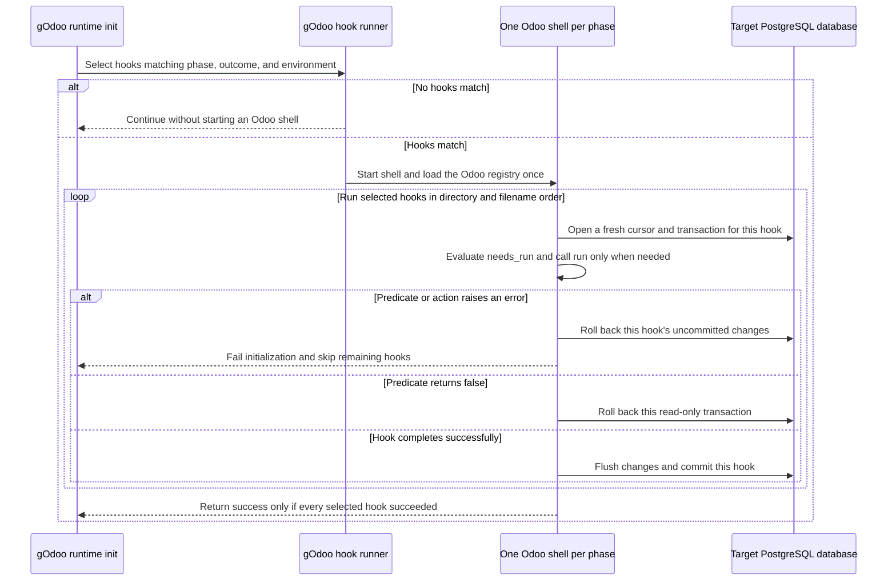

# Lifecycle hooks and native migrations

[Documentation](../README.md#documentation) · [Runtime lifecycle](lifecycle.md) · [Downstream setup](downstream.md)

Use **native Odoo migrations for versioned repairs** and **gOdoo hooks for module requests and environment policy**.
Ordinary restores and major upgrades share the same initialization flow.

## Choose the right mechanism

| Work                                      | Mechanism                                                         | Runs when                                                           |
| ----------------------------------------- | ----------------------------------------------------------------- | ------------------------------------------------------------------- |
| Versioned schema or data repair           | Addon `migrations/<version>/pre-*.py`, `post-*.py`, or `end-*.py` | An eligible installed-to-manifest version change occurs.            |
| External migration roots                  | Explicit `--upgrade-path`                                         | Selected module updates invoke Odoo's loader.                       |
| Cursor-based work before registry loading | Explicit `--pre-upgrade-script`                                   | An update selection exists; maps to native `--pre-upgrade-scripts`. |
| Choose modules to install/update          | `prepare` hook                                                    | Each initialization attempt, before dependency preflight.           |
| Bootstrap or restore setup                | `after_bootstrap` / `after_restore` hook                          | The matching initialization outcome applies.                        |
| Recurring environment policy              | `after_reconcile` hook                                            | Reconciliation succeeds and declaration filters match.              |

Native migration versions must be above the installed version and at or below the manifest version. Fresh installs need
their own install behavior. There is no transition directory, version-pair selector, implicit module list, or hook
implicit migration scheduler. Ordinary database hooks can opt into transactional one-shot completion with `once=True`.

## Discover and select hooks

```bash
# Run in a configured runtime. Directories are processed in supplied order.
# This is explicit reconciliation even if conditional startup is enabled.
godoo runtime init --no-if-needed \
  --hooks-dir /path/to/shared-hooks \
  --hooks-dir /path/to/project-hooks
```

`GODOO_HOOK_DIRS` supplies the environment fallback. Relative directories resolve from the project working directory.
Resolved directories are deduplicated; immediate `*.py` children run in filename order. Discovery neither recurses nor
automatically scans the project, and the CLI accepts directories rather than individual files.

Missing directories, malformed declarations, duplicate IDs, and unknown phases/outcomes fail before lifecycle mutation.
Discovery imports definitions and validates declarations without calling database predicates. Keep files safe to import
without Odoo: put Odoo imports inside database callbacks and perform no work at module scope.

### Declaration reference

Every file declares `HOOK = Hook(...)` and defines `run(ctx)`. Optional `needs_run(ctx)` must be read-only and return an
actual boolean. A missing predicate runs whenever eligible; an exception fails initialization.

| Field          | Contract                                                                                                                         |
| -------------- | -------------------------------------------------------------------------------------------------------------------------------- |
| `id`           | Required, nonempty stable identifier independent of the filename.                                                                |
| `phase`        | `prepare`, `after_bootstrap`, `after_restore`, or `after_reconcile`.                                                             |
| `on`           | Tuple of `ready`, `bootstrapped`, and/or `restored`; defaults to all. Custom outcome filters are invalid for preparation.        |
| `environments` | Optional tuple of exact `GODOO_ENVIRONMENT` values. Omitted means unrestricted; an allowlist never matches an unset environment. |
| `once`         | Optional boolean, default false. Record successful database-hook completion; preparation hooks cannot use it.                    |

Environment is a deployment input, never inferred from database contents.

## Request modules before preflight

```python
# hooks/10_modules.py
from godoo_cli.runtime.hooks import Hook

HOOK = Hook(id="project.modules", phase="prepare")


def run(ctx):
    # Merge with CLI/environment requests; names deduplicate in first-seen order.
    ctx.request_modules(update=["project_base"], install=["helpdesk"])
```

Preparation runs without starting Odoo and recomputes requests on every retry. Its context exposes `environment` and
`request_modules(update=..., install=...)`, with no `env`. Preparation must not mutate databases or external systems. No
request means no implicit action; even `all` requires an explicit request. Upgrade paths and pre-upgrade scripts remain
explicit CLI/environment inputs.

## Reconcile database state

```python
# hooks/90_neutralize.py
from godoo_cli.runtime.hooks import Hook

HOOK = Hook(
    id="project.neutralize",
    phase="after_reconcile",  # Run after native module loading.
    on=("restored",),
    environments=("development", "review", "staging"),
)


def needs_run(ctx):
    # Observe durable database state rather than remembering a previous attempt.
    return not bool(ctx.env["ir.config_parameter"].sudo().get_param("database.is_neutralized"))


def run(ctx):
    # Odoo is available only inside a database callback.
    from odoo.modules.neutralize import neutralize_database

    neutralize_database(ctx.env.cr)
```

Database contexts expose `ctx.env`, `ctx.environment`, and the original `ctx.outcome`. They cannot request modules, read
lifecycle markers as an API, rebuild the registry, or perform immediate module installs/updates. Module loading belongs
in native reconciliation.

An eligible `after_restore` database hook conflicts with native pre-upgrade scripts because it would open the registry
first. The combination is rejected before mutation. Put post-upgrade environment setup in `after_reconcile`.

## Execution and transaction boundaries

Declaration filters run before starting a subprocess. An empty phase starts no Odoo shell. Otherwise the runner uses the
configured executable, interpreter, database target, addon paths, and native upgrade paths:



On failure, the runner rolls back uncommitted work, stops the phase, and propagates the subprocess error to init.
Earlier hooks that already committed remain committed if a later hook fails. Database hooks run sequentially. Fresh
environments prevent stale transaction state leaking between hooks. The runner owns normal commit/rollback; native
module reconciliation runs in a separate process.

Odoo operations may commit internally, and external effects cannot be rolled back by the runner. Actions still need
durable state guards and must remain safe after partial work. Logs identify each hook and its decision: excluded,
already satisfied, running, completed, or failed. Do not log passwords or complete environment maps.

## Idempotence and recovery

Ordinary hooks run whenever eligible, subject to `needs_run`. `on=("restored",)` selects restore initialization and its
retries; it is not a completion record.

Use `Hook(id="project.repair.2026_10", phase="after_reconcile", once=True)` for a transactional one-shot repair. IDs are
immutable: use a new ID for a new repair. The runner stores completion in `ir_config_parameter` under
`godoo.hooks.once.<identity-hash>`, in the same transaction as the action. Unrestricted hooks complete globally in that
database; environment-restricted hooks complete separately for each selected environment. Restores and baseline resets
carry or rewind the records with the database. Declaration filters still apply, and duplicate IDs remain invalid.

Completed hooks skip `needs_run`. A false predicate means the desired state is already satisfied and records completion
atomically without running the action. An exception rolls back the action and its completion record. A later hook's
failure preserves earlier committed repairs. Hooks that commit internally or change external systems still need their
own idempotency: the runner cannot promise exactly-once external effects. Keep recurring environment policy repeatable,
with state predicates, so ordinary drift is repaired after every controlled start.

| Attempt                                        | Outcome visible to hooks                                                            |
| ---------------------------------------------- | ----------------------------------------------------------------------------------- |
| Initial restore                                | `restored`                                                                          |
| Retry after failed initialization              | Original `restored` or `bootstrapped` outcome, even though the database now exists. |
| Ordinary init after a completed initialization | `ready`                                                                             |

The lifecycle marker preserves the original outcome until all phases succeed. A retry evaluates current state again.

Write predicates and actions around observable invariants:

- Compute desired values once in a helper shared by predicate and action.
- Identify managed records by stable keys; fail on ambiguous matches or schema mismatches.
- Write only changed fields and delete only remaining matches; repeated writes may trigger tracking or hashing.
- Let failures propagate, including after partial internal commits.
- Give external actions their own operation-specific idempotency mechanism.

### Native migration failures

Odoo can commit an addon's target version before its `end-` migrations finish. Later failure can roll back repair writes
while leaving that version advanced, causing another update to skip the repair.

Verify the repair's actual data invariants. Neither a log entry nor an installed version proves completion. When
completion cannot be established, fix the cause and restore the matching pre-attempt database and filestore. A pending
gOdoo marker cannot force native migration replay. Do not edit module versions to force it or add a second migration
ledger.

## Restore selection and downstream acceptance

```bash
# Ordinary input: an old upgraded.zip beside the dump has no effect.
godoo runtime init --dump-path /restore/dataset

# Upgrade input: explicitly select the ZIP paired with the original filestore.
godoo runtime init --dump-path /restore/dataset --seed /restore/dataset/upgraded.zip
```

Seeds do not replace initialized databases. Archive validation, attachment overlays, retry handling, and version guards
apply to both flows.

For the Odoo_1 16-to-19 integration, downstream owns native pre-upgrade/addon repairs, module-request hooks,
non-production neutralization, audit cleanup, SMTP routing, checksum policy, and local provisioning. Pre-upgrade cleanup
must inspect actual module/data state so it also accepts an already upgraded 19 dump. Check manifest versions against
the upgraded fixture.

## Validation

| Layer                   | Required proof                                                                                                                                  |
| ----------------------- | ----------------------------------------------------------------------------------------------------------------------------------------------- |
| Discovery and filtering | Stable order/IDs, validation before mutation, strict predicates, and exclusion without shell startup.                                           |
| Execution               | One registry per phase, separate hook transactions, additive module requests, and preparation replay.                                           |
| Failure and retry       | Predicate failure, action failure, partial internal commit, propagated errors, and preserved outcome.                                           |
| Restore selection       | Plain dump versus explicitly selected upgraded ZIP; native pre-upgrade ordering.                                                                |
| Downstream acceptance   | Real upgraded archive, later ordinary 19 dump, retry, repeated init without extra writes, changed configuration, and module/environment policy. |

Run lint and repository tests sequentially, relevant typing checks, and available isolated Odoo integration. Use test
databases separated from production and existing project databases. Mocked batches do not establish a successful archive
restore. Report editor UI, archive upgrade, ordinary restore, and installed-package adoption as separate evidence.
