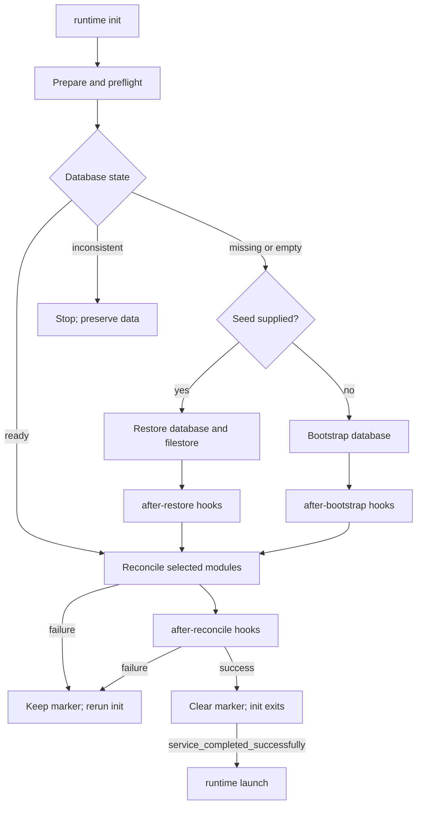
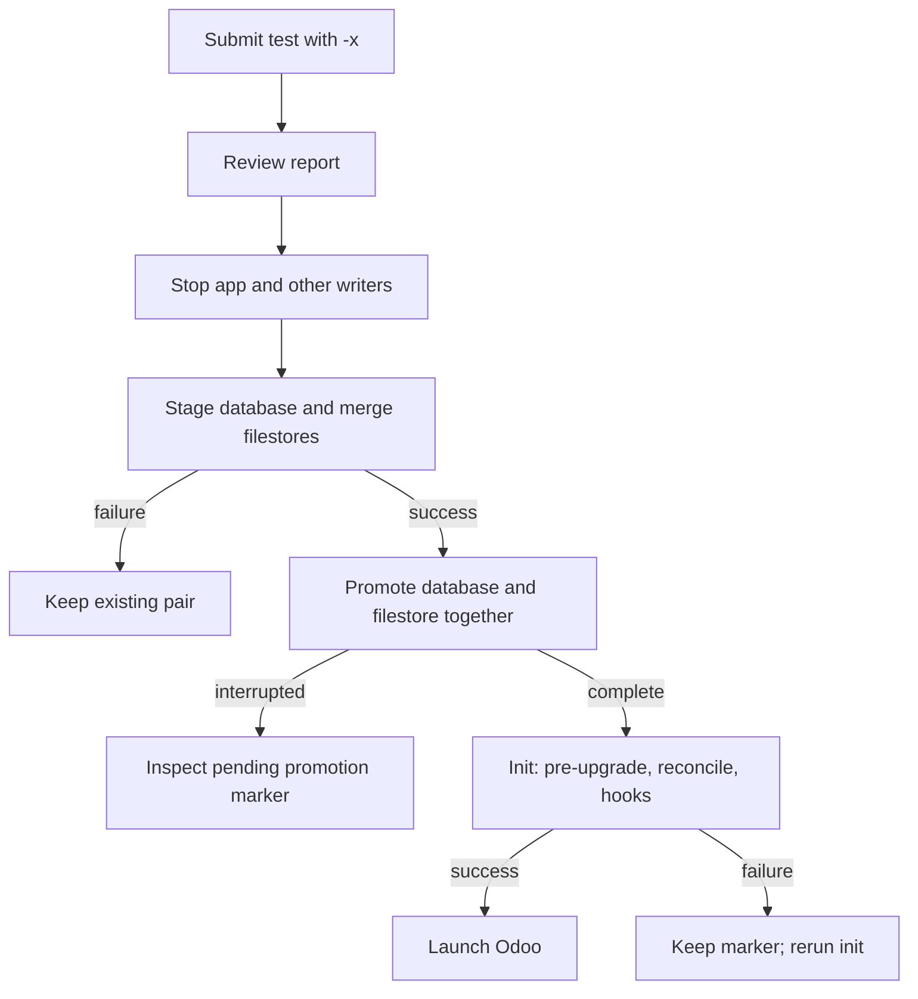

# Runtime lifecycle

A runtime is one PostgreSQL database and its matching filestore. Stop ordinary Odoo writers before initialization,
restore, clone, or replacement; gOdoo locks coordinate gOdoo operations only.

- Configuration precedence: CLI, exported environment, project `.env`. A Compose database target remains the target.
- `runtime init` prepares and reconciles once, then exits. `runtime launch` starts Odoo after init succeeds.
- Seed archives apply only to missing or empty databases.
- A missing or empty database with a nonempty filestore is inconsistent and needs matching-pair recovery.



## Initialize and launch

```bash
# Run against the downstream project's configured database.
godoo runtime init \
  && godoo runtime launch
```

### Fixed runtime datasets

Set `GODOO_DUMP_PATH` or pass `--dump-path` to a mounted dataset directory. The directory contains `odoo.dump` and the
original source filestore at `odoo_filestore/filestore/odoo`. Init restores that plain pair into the configured runtime
database.

For a custom-format `odoo.dump`, set `GODOO_RESTORE_JOBS` or pass `--restore-jobs` to control `pg_restore` workers. It
defaults to one. ZIP dataset restores use `psql` and cannot parallelize this way.

For an official major upgrade, explicitly select `upgraded.zip` with `--seed` and overlay it on the original filestore.
When `--seed` selects that paired `upgraded.zip`, init infers the original filestore unless `--original-filestore` names
one explicitly. Invalid dumps, ZIPs, or required filestores fail before init changes the database or filestore.

```bash
godoo runtime init --dump-path /restore/dataset
godoo runtime init --dump-path /restore/dataset --seed /restore/dataset/upgraded.zip
```

- Launch checks the Odoo version, pending recovery, and process dependencies before starting the server.
- If `ODOO_BANNER_TEXT` or `ODOO_BANNER_BG_COLOR` is non-empty, launch applies the bundled banner script first, in
  either runtime mode. Unset or blank banner settings skip this update. A failed update prevents server startup.
- Runtime commands require Odoo 16 or newer. Backups use native Odoo commands on 19 or newer and PostgreSQL tools on
  16–18. ZIP restores stage SQL and filestore files before promotion; `runtime init` runs Odoo afterward. Archive
  extraction and optional full CRC verification report bytes processed at most every five seconds plus final
  measurements. Phases without measured progress report elapsed time every ten seconds. On Linux, gOdoo probes cloning
  with one nonempty filestore file before attempting a recursive reflink copy. If cloning is unavailable, it immediately
  falls back to rsync. INFO logs identify the selected copy method and any fallback or partial-stage cleanup. Rsync
  writes its progress and diagnostics directly to stdout; when it is unavailable, gOdoo uses its Python copy fallback.
  SQL staging sends native `pv` progress to stderr when present and reports bytes sent otherwise. SQL restore discards
  query-result tables while keeping PostgreSQL diagnostics on stderr. Input reaching 100% means the dump has been sent;
  PostgreSQL may still be working. The original-filestore copy and database restore report start and completion or
  failure.
- `runtime status` is read-only. `runtime shell` and `runtime shell-script` start explicit Odoo shell sessions.
- `--update` and `--install` select module reconciliation. `--report-url` or `GODOO_REPORT_URL` sets Odoo's `report.url`
  after successful init; it is required when `--x-sendfile` or `GODOO_X_SENDFILE` is enabled.
- Select lifecycle hooks with repeatable `--hooks-dir` or `GODOO_HOOK_DIRS`. Each file declares its phase, applicable
  outcomes, and environments, with optional `needs_run(ctx)`. Database hooks share one Odoo registry per phase and use
  separate transactions. Preparation hooks run without starting Odoo. See the [hook contract](hooks.md).

ZIP restores validate the archive structure, required dump, filestore paths, and archive identity by default. Pass
`--verify-archive-crc` to `godoo db restore` or `godoo runtime init`, or set `GODOO_VERIFY_ARCHIVE_CRC=true`, to verify
all ZIP members before restore. The default is false; `--no-verify-archive-crc` overrides an enabled environment value.
CRC checks detect accidental corruption, not the archive's origin. Restored members always retain Python's ZIP CRC
checks during extraction. With an original filestore, restore preparation extracts the SQL dump and archive overlay once
and reuses those staged files. Enabling full verification also checks unused ZIP members in the same pass.

Init checks module dependencies before reading ZIP payloads. It prepares the archive only when a missing or empty
database requires a restore. An existing bootstrapped database, including an incomplete initialization retry, skips ZIP
extraction and resumes reconciliation and hooks. A missing-addon error during preflight therefore fails without
extracting the archive.

`Preparing runtime archive for restore` identifies necessary extraction work. ZIP CRC checks run while reading the SQL
dump and filestore; the default log explicitly says the full-archive scan is disabled. The reported extraction bytes are
uncompressed content processed. `GODOO_VERIFY_ARCHIVE_CRC=false` skips the optional scan, but does not disable integrity
checks on extracted members or the extraction needed for a restore.

Filestore transfers from a host bind mount into a VM volume must read and create each file across the filesystem
boundary. A fast SSD does not eliminate that per-file cost. For repeated restores, keeping a reusable source in a native
Linux volume can avoid later host transfers and allow reflink copies when both locations support them. This adds a
persistent source copy, so weigh the storage cost before changing a downstream mount. Reset baselines may share reflink
extents with the runtime; logical directory sizes can count those shared bytes more than once.

Dependency installation, custom dump checks and restores, and filestore copies report elapsed time every ten seconds.
The official upgrade client records phase start, completion, or failure without a heartbeat, while its native output is
unchanged. Child output, including interactive shells and the running Odoo server, keeps its native streams.

## Native migrations and reconciliation hooks

Major and minor upgrades use the same native Odoo reconciliation. Select modules directly with `--update` and
`--install`, or declare them in a `prepare` hook using `ctx.request_modules`. Requests merge and deduplicate; there is
no implicit update of all modules. Native `--upgrade-path` and `--pre-upgrade-script` remain explicit inputs.

Versioned schema and data repairs belong in Odoo addon `migrations/<version>/pre-*.py`, `post-*.py`, or `end-*.py`,
including external migration roots passed with `--upgrade-path`. The migration version must lie above the installed
version and at or below the manifest version. Fresh installations need their own install behavior.

Use [gOdoo hooks](hooks.md) for module requests and recurring environment policy. All hooks declare `HOOK = Hook(...)`
and implement `run(ctx)`, with optional read-only `needs_run(ctx)`. Database hooks receive `ctx.env`, `ctx.environment`,
and the original `ctx.outcome`; they do not read lifecycle marker files. A failed hook keeps init incomplete. Retrying
checks current state again and preserves the restore/bootstrap outcome until initialization succeeds.

Hook declarations, configured runtime version, and dependencies known before restore are checked before mutation.
Dependencies discovered from the restored database are checked afterward. A failure at that point leaves init
incomplete: repair the dependency and rerun init without restoring the seed again.

If native module loading or an Odoo migration fails after it starts changing the database, verify the actual repair
results before accepting a retry. Odoo can commit an addon's target version before `end-` scripts complete; a subsequent
update may skip repairs whose writes were rolled back. If their completion is uncertain, restore the matching
pre-attempt pair after fixing the cause. See [native migration recovery](hooks.md#idempotence-and-recovery).

## Official and major-version upgrades

`godoo upgrade` fetches Odoo's official client and forwards its arguments. HTTPS certificate and hostname verification
is enabled by default. Set `GODOO_UPGRADE_SSL=0` only for an upgrade endpoint with a certificate your host cannot
verify; gOdoo keeps HTTPS encryption but disables verification for its download and the official client it runs.

- Operations: `test`, `production`, `restore`, `status`, `log`, and `wipe`.
- Pass `-x` to suppress the official client's local restore of a test result. Review the report before restore.
- Use `production` only when the upgrade is ready.

```bash
# Submit for testing; -x keeps the result out of the local runtime.
godoo upgrade test -i ORIGINAL_DUMP -t 19.0 -c CONTRACT -x
```

- `--original-filestore` must name the source database directory, such as `ODOO_DUMP_VARLIB_FOLDER/filestore/SOURCE_DB`;
  do not pass its parent or another nested `filestore/<database>` path.
- gOdoo copies original files to staging, then overlays archive files. Original-only files remain; ZIP files replace
  collisions. Staged files are independent regular files, using filesystem cloning when available and copy otherwise.
- Archive and source-tree checks happen before database mutation. Without this option, normal ZIP restore behavior is
  unchanged.

The option or `GODOO_ORIGINAL_FILESTORE` works with `godoo db restore` and `godoo runtime init --seed`.

An initialized database from an older Odoo major fails the runtime-version guard before preparation or reconciliation;
`--seed` cannot replace it. Stop the app and other database writers, then load the upgraded pair and initialize:

```bash
# Stop downstream app services and other database writers first.
godoo db restore RESULT.zip --original-filestore /path/to/filestore/SOURCE_DB --force \
  && godoo runtime init --update your_modules --pre-upgrade-script /path/to/migrate.py \
  && godoo runtime launch
```

- `--pre-upgrade-script` runs before Odoo opens the registry and requires `--update`.
- Do not select an applicable `after_restore` database hook together with `--pre-upgrade-script`; it would open the
  registry first. Put environment setup in `after_reconcile` so native pre-upgrade work runs first.
- `--upgrade-path` also requires `--update`. Keep the source dump and filestore for recovery; completed Odoo changes are
  not automatically rolled back.



## Reset a development runtime

Development Compose enables `GODOO_KEEP_RESET_BASELINE`. Each successful restore saves an independent database and
filestore pair before initialization, migrations, and hooks. The equivalent option is `--keep-reset-baseline` on
`godoo runtime init` or `godoo db restore`; it is off by default outside development. A fresh restore replaces the saved
baseline. Bootstrap alone does not create one.

- `make reset` stops the stack, starts PostgreSQL for the reset, and restores the saved baseline. Containers and volumes
  remain, and Odoo stays stopped. Run `make dev` afterward to initialize and launch this repository's development stack.
- `make reset-hard` removes the containers and volumes, including the saved baseline.
- `godoo db reset` performs the database and filestore operation; callers must stop Odoo writers first. `--db-template`
  can select another database with a matching filestore. `--empty` retains its existing drop-only behavior.

Reset copies the baseline database and uses rsync to restore its filestore, deleting files absent from the baseline. It
uses PostgreSQL's faster copy method when available. The baseline remains unchanged for subsequent resets.

An interrupted reset may leave the active filestore incomplete. Its pending marker blocks initialization; rerun
`make reset` to restore the pair. A missing or incomplete baseline requires a fresh restore before reset can proceed.
After a successful reset, the next initialization reruns restore hooks, reconciliation, and migration hooks.

## Status and recovery

`godoo runtime status --json` is read-only and returns:

| State          | Exit code |
| -------------- | --------: |
| `ready`        |         0 |
| `missing`      |        20 |
| `empty`        |        21 |
| `inconsistent` |        22 |
| `incomplete`   |        23 |
| `unavailable`  |         1 |

`incomplete` means initialization can be retried with the same inputs. `inconsistent` requires inspecting and recovering
the database and filestore first. A downstream init wrapper may retry exit 23 while refusing exit 22.

Status reads production provenance from `/odoo/godoo-source-provenance.json`; `--provenance-path` overrides it. Missing
provenance does not establish release identity. It does not write runtime state or inspect host source roots.

### Locks

- Every container managing a runtime must share its data volume at the same `data_dir`.
- Locks under `<data_dir>/.godoo/locks/` coordinate gOdoo only; ordinary Odoo writes do not take them.
- Clones lock source and target in order; nested restore calls reuse held locks.
- Lock files remain after release; do not remove them while a process may wait.

### Incomplete initialization

Init writes a marker under `.godoo/pending-lifecycle/` before changing the runtime and removes it after success. Status
reports an incomplete runtime and launch refuses to start while the marker exists.

After fixing a failure, rerun init. It keeps an initialized database, reruns the bootstrap or restore hooks associated
with the incomplete attempt, then reruns reconciliation and final hooks. Hooks must be safe to run again. Init does not
resume a saved phase or compare the new selection with a persisted plan.

Resetting to the saved baseline marks the runtime as restored, so the next init runs restore hooks again. Older recovery
markers require restoring or resetting the database and filestore before initialization.

### Interrupted restore

- SQL errors leave the previous database and filestore in place.
- Promotion retains the old database until the filestore swap succeeds and rolls back a failed swap.
- `.godoo/pending-restores/` marks promotion. After interruption, status reports `inconsistent` and init refuses to
  guess.
- Inspect the database, filestore, backups, and marker before recovery; do not delete the marker to clear the state.
- Init clears lifecycle state only after preflight, reconciliation, and hooks succeed.

- gOdoo forwards SIGINT and SIGTERM to child processes, waits for shutdown, and preserves their exit status.

Use `godoo runtime --help` and `godoo db --help` for current commands. See [downstream runtime setup](downstream.md) for
the service contract.
