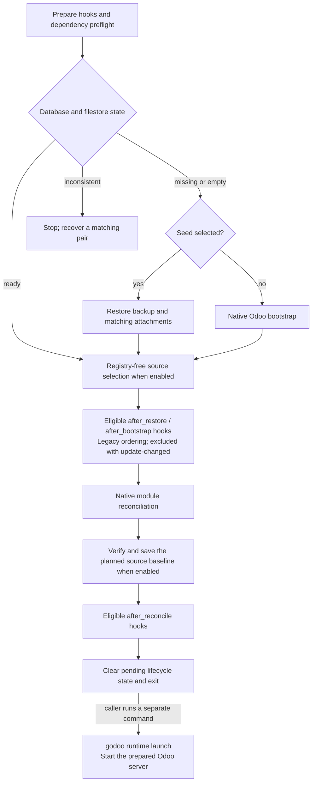
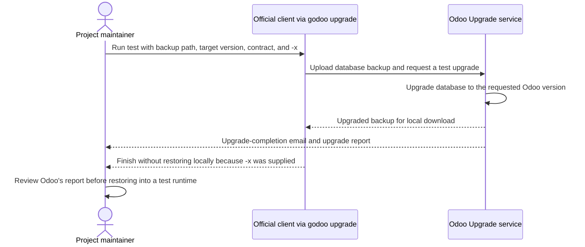
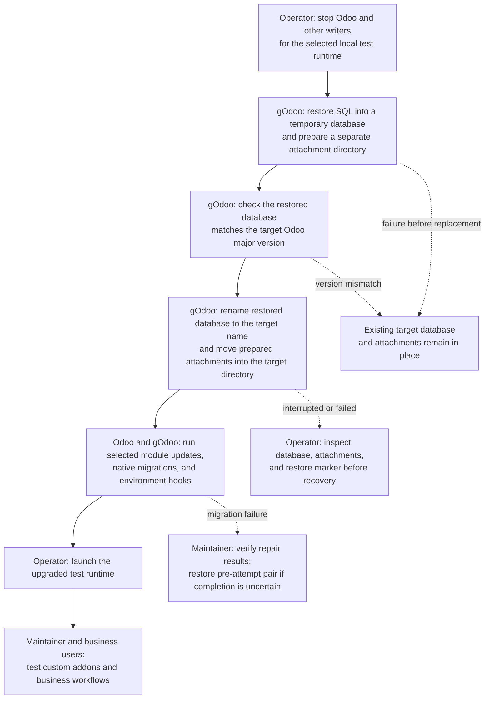

# Runtime lifecycle

[Documentation](../README.md#documentation) · [Hooks](hooks.md) · [Downstream setup](downstream.md)

A runtime is **one PostgreSQL database and its matching filestore**. Initialize the pair, reconcile selected modules and
hooks, then launch Odoo. Runtime commands require Odoo 16 or newer.

Stop ordinary Odoo writers before initialization, restore, clone, or replacement. gOdoo locks coordinate gOdoo
operations; they do not stop ordinary Odoo writes.

## Initialize and launch

Run in the configured downstream runtime environment. CLI values override exported environment values, then the project
`.env`; the resolved database target remains the target throughout the operation.

```bash
# Prepare and reconcile explicitly, including on an already ready database.
# Other Odoo writers must be stopped.
godoo runtime init --update-changed && godoo runtime launch

# For ordinary startup, skip initialization when the runtime is already ready.
godoo runtime init --if-needed && godoo runtime launch

# Inspect state without changing the runtime.
godoo runtime status --json
```

These are alternative startup policies. Set `GODOO_INIT_IF_EMPTY=true` for conditional startup; use `--no-if-needed` to
override it for deployment jobs that must apply updates or hooks. Conditional init prints the same JSON payload as
`runtime status --json` and checks readiness before loading datasets, hooks, or Odoo.

The diagram below starts when initialization is required or explicitly requested. A ready runtime skipped by
`--if-needed` exits before this work. Each arrow means the preceding step succeeded; failures stop initialization.
Launching the server is a separate caller action. The bootstrap/restore branches show first initialization; recovery
retries rerun hooks for the original outcome, as described under
[incomplete initialization](#incomplete-initialization).



Init is a one-shot job. In Compose, launch depends on init's `service_completed_successfully`; gOdoo does not start
downstream services itself.

### Source-driven native reconciliation

`--update-changed` or `GODOO_UPDATE_CHANGED=true` selects source changes without loading an Odoo registry. Under the
runtime lock, after restore/bootstrap and before database hooks, gOdoo reads installed and pending module state and
compares source snapshots. A missing baseline deliberately upgrades installed source-backed modules once. Later
unchanged starts request no native updates. Explicit `--update` selections remain explicit; desired installs already
installed or queued for upgrade are filtered out. Native Odoo expands upgrade dependents and installs new dependencies.
Pending install/upgrade states are included; pending removals need a selected native action or initialization fails.

The independent `godoo.runtime.source_checksums.v1` parameter stores JSON `{"format": 1, "modules": {name: sha256}}`.
Hashes include deterministic relative filenames and content, all translations regardless of active languages, and core
Python package sources as part of `base`. Tests, static assets, Git metadata, Python bytecode, and editor swap files are
excluded. Installed, pending, and requested addons plus their source dependencies are snapshotted before native work. If
that set can introduce installs, potential auto-install addons and their dependencies are captured too. Unrelated
ordinary addons are not hashed unless the caller explicitly selects `all`. Imported addons and pathless Studio
customization are not source modules. Corrupt baseline data fails visibly.

Missing installed sources may be deferred only when a selected native update will run configured pre-upgrade cleanup.
They must be removed or repaired before a strict post-native rescan. Other missing sources fail initialization. Valid
native upgrade paths can remain configured without forcing an update; pre-upgrade scripts run only with native update
selections. These settings are dormant on unchanged starts.

Only a successful native process with no unfinished module states can advance the baseline. gOdoo verifies final
installed sources against the snapshot taken before native work and saves that snapshot before post-hooks. Source drift
or failed native work leaves the old baseline; failed post-hooks retain the successful baseline and earlier completed
one-shot hooks. The pending lifecycle marker remains until all phases succeed. Native Odoo can commit partial work; this
is not an atomic module-upgrade guarantee. See the native migration recovery limits in [Hooks](hooks.md).

Backups use native Odoo commands on Odoo 19 or newer and PostgreSQL tools on Odoo 16–18.

## Select restore inputs

A seed initializes only a missing or empty database. It cannot replace an initialized database. A missing or empty
database with a nonempty filestore is inconsistent and requires matching-pair recovery.

```text
/restore/dataset/
├── odoo.dump                       # Ordinary database input.
├── upgraded.zip                    # Optional official upgrade result; explicit selection only.
└── odoo_filestore/filestore/odoo/   # Original attachments paired with the dump.
```

Choose the appropriate input:

```bash
# Ordinary restore: select odoo.dump and its original filestore.
godoo runtime init --dump-path /restore/dataset

# Official upgrade result: explicitly select the ZIP paired with this dataset.
# Init infers the original filestore unless --original-filestore overrides it.
godoo runtime init --dump-path /restore/dataset --seed /restore/dataset/upgraded.zip
```

| Option / environment                                | Behavior                                                                                                           |
| --------------------------------------------------- | ------------------------------------------------------------------------------------------------------------------ |
| `--dump-path` / `GODOO_DUMP_PATH`                   | Select the fixed dataset directory visible to the process.                                                         |
| `--seed` / `GODOO_RUNTIME_SEED`                     | Select an explicit ZIP; an old `upgraded.zip` never selects itself.                                                |
| `--original-filestore` / `GODOO_ORIGINAL_FILESTORE` | Override the original source database's attachment directory.                                                      |
| `--restore-jobs` / `GODOO_RESTORE_JOBS`             | Set `pg_restore` workers for custom-format dumps; default one. ZIP SQL restores use `psql`.                        |
| `--odoo-demo` / `GODOO_RUNTIME_DEMO=true`           | Bootstrap with demo data and ignore configured dataset and original-filestore paths. An explicit seed is an error. |

A ready runtime skipped by `--if-needed` also skips restore-input checks. Otherwise invalid dumps, ZIPs, and required
filestores fail before init changes the database or filestore.

### Validation, extraction, and progress

Init checks known module dependencies before reading ZIP payloads. It extracts archives only when a missing or empty
database requires restore. An initialized database, including an incomplete-init retry, skips extraction and proceeds
with reconciliation and hooks.

| Stage                  | What the output means                                                                                                                                         |
| ---------------------- | ------------------------------------------------------------------------------------------------------------------------------------------------------------- |
| Archive preparation    | `Preparing runtime archive for restore` marks required extraction. Byte counts describe uncompressed content processed.                                       |
| ZIP integrity          | Structure, dump, paths, identity, and CRCs of extracted members are checked by default.                                                                       |
| Optional full CRC scan | `--verify-archive-crc` or `GODOO_VERIFY_ARCHIVE_CRC=true` also checks unused ZIP members. Default false; `--no-verify-archive-crc` overrides the environment. |
| SQL transfer           | Terminal stderr uses `pv` when available; captured output logs bytes and percentages as complete lines. **100% means input sent**, not restore complete.      |
| SQL execution          | Query-result tables are discarded; PostgreSQL diagnostics remain on stderr.                                                                                   |
| Filestore transfer     | Logs show the copy method, fallback, cleanup, and completion or failure. Rsync keeps its native output.                                                       |
| Quiet finite work      | Dependency installation, dump checks/restores, Git fetches, and copies report elapsed time every ten seconds.                                                 |

Extraction and full-scan progress reports occur at most every five seconds plus final measurements. With an original
filestore, SQL and archive overlays are staged once and reused. Disabling the full scan keeps extraction integrity
checks. CRC checks detect accidental corruption; they do not establish the archive's origin.

On Linux, gOdoo probes one nonempty file before recursive reflink copying, then falls back to rsync or Python copying.
Rsync shows progress only when stdout is a terminal; diagnostics remain visible in captured output. Desktop bind mounts
can make many small attachment copies expensive; see [dataset storage](downstream.md#restore-dataset-storage). Reset
baselines can share reflink extents, so logical sizes may count shared data more than once.

The official upgrade client reports phase start and completion or failure without a heartbeat. Child processes retain
their native streams. gOdoo forwards SIGINT/SIGTERM, waits for shutdown, and preserves child exit status.

## Native migrations and reconciliation hooks

Select modules with `--update`, `--install`, or a preparation hook's `ctx.request_modules`. Requests merge and
deduplicate; no modules, including `all`, are implicitly selected.

```bash
# Explicit reconciliation; native paths and scripts require an update selection.
godoo runtime init --no-if-needed \
  --update your_module \
  --upgrade-path /path/to/migrations \
  --pre-upgrade-script /path/to/pre-upgrade.py \
  --hooks-dir /path/to/hooks
```

Odoo owns versioned repairs in addon `migrations/<version>/pre-*.py`, `post-*.py`, and `end-*.py`. The migration version
must be above the installed version and at or below the manifest version; fresh installs need their own install
behavior. gOdoo hooks own module requests and recurring environment policy.

Hook declarations, configured runtime version, and dependencies known before restore fail before mutation. Dependencies
discovered from the restored database are checked afterward; repair a failure and rerun init. Each database-hook phase
loads one registry and gives each hook a separate transaction. See the [hook contract](hooks.md).

Native migrations require special recovery checks: Odoo can commit a module's target version before its `end-`
migrations complete. A retry may skip repairs whose writes were rolled back. Verify the actual repair results; when
completion is uncertain, fix the cause and restore the pre-attempt database/filestore pair. See
[idempotence and recovery](hooks.md#idempotence-and-recovery).

## Official and major-version upgrades

`godoo upgrade` fetches Odoo's official client and forwards arguments for `test`, `production`, `restore`, `status`,
`log`, and `wipe`.

### Request an upgraded test backup

The project maintainer runs the client against [Odoo's Upgrade service](https://upgrade.odoo.com/). The `test` operation
uploads the database backup for conversion to the requested Odoo version. It does not run gOdoo's repository tests. The
original production filestore stays with the project and must be paired with the returned backup for local testing.

```bash
# Upload the database backup to Odoo's Upgrade service for a test upgrade.
# -x downloads the result without the client's automatic local restore.
# Replace the dump path and Enterprise contract with your own values.
godoo upgrade test -i /path/to/odoo.dump -t 19.0 -c YOUR_CONTRACT -x
```



Before downloading the official client, `godoo upgrade` logs the modification date and absolute path of the dump
selected by `-i` / `--dump` and the adjacent `odoo_filestore` directory. Dates include the local timezone offset. The
filestore stays local for restoring the result. Its directory timestamp reflects changes to immediate entries, not
changes throughout the attachment tree or proof that the dump and filestore were captured together. Missing metadata
produces a warning; the official client still owns input validation. Commands without a dump do not log source dates.

HTTPS certificate and hostname verification is enabled by default. `GODOO_UPGRADE_SSL=0` disables verification for both
the download and client while retaining HTTPS encryption; use it only for an endpoint whose certificate the host cannot
verify.

Odoo's upgrade report describes changes made by the upgrade. The project maintainer reviews the report attached to the
upgrade-completion email; it is also available to Settings administrators in the restored database's Discuss app. This
review does not establish that custom addons or business workflows work. After restoring a test runtime, the maintainer
and business users test those workflows before planning a production upgrade. See
[Odoo's upgrade procedure](https://www.odoo.com/documentation/19.0/administration/upgrade.html).

### Restore the result into a local test runtime

Configure the command below for the intended **test database and data directory**, with the target-version Odoo and
custom-addon sources available. The operator stops that runtime's Odoo processes and any other database writers first.

An older-major initialized database fails the runtime version guard; `--seed` cannot replace it. Explicit
`db restore --force` replaces the configured target with the reviewed upgrade result:

```bash
# Replace the configured, stopped TEST runtime with Odoo's returned backup.
# Keep the original backup and attachments available for recovery.
# --original-filestore names the source database directory, not its parent.
godoo db restore /path/to/upgraded.zip \
  --original-filestore /path/to/filestore/SOURCE_DB --force \
  && godoo runtime init --no-if-needed --update your_modules \
    --pre-upgrade-script /path/to/pre-upgrade.py \
  && godoo runtime launch
```

The restore has two distinct parts:

| Term in gOdoo logs | Concrete operation                                                                                                                                                                                                                                                                      |
| ------------------ | --------------------------------------------------------------------------------------------------------------------------------------------------------------------------------------------------------------------------------------------------------------------------------------- |
| **Staging**        | Restore the ZIP's SQL into a temporary PostgreSQL database. Prepare a separate attachment directory by copying the original filestore and overlaying files from the ZIP. Check the restored Odoo major version before replacing the target.                                             |
| **Promotion**      | Rename the existing target database to a temporary backup name, then rename the restored database to the configured target name. Move the prepared attachment directory into the target filestore path. After replacement succeeds, remove the old copies and clear the restore marker. |

The temporary database and attachment directory are the **staged pair**. They are not an Odoo staging deployment.
Original-only attachments remain; ZIP files replace collisions. Prepared files are independent regular files, using
filesystem cloning where supported. Without `--original-filestore`, normal ZIP restore behavior is unchanged.

Database renames and filesystem moves are separate operations, coordinated by a restore marker. They are not one
database transaction. If preparation fails, the existing target pair stays in place. A failed filestore replacement
attempts to restore the prior database; an interrupted or failed switch requires inspecting both artifacts and the
retained marker before retrying.



`--pre-upgrade-script` runs before Odoo opens the registry and maps to native `--pre-upgrade-scripts`. Both it and
`--upgrade-path` require `--update`. An applicable `after_restore` database hook conflicts with native pre-upgrade
scripts and is rejected before mutation; put environment setup in `after_reconcile`.

## Reset a development runtime

Development Compose enables `GODOO_KEEP_RESET_BASELINE`. A successful restore saves an independent database/filestore
pair **before initialization, migrations, and hooks**. A fresh restore replaces it; bootstrap alone creates no baseline.
Outside development, opt in with `--keep-reset-baseline` on init or restore.

```bash
# Stop this example stack and restore its saved baseline; leave Odoo stopped.
make reset

# Initialize the restored baseline and start development again.
make dev

# Destructive alternative: remove stack volumes, including the saved baseline.
# make reset-hard
```

`godoo db reset` performs the pair operation; callers must stop writers first. `--db-template` selects another database
with its matching filestore; `--empty` retains drop-only behavior. Reset copies the database and uses rsync to delete
filestore files absent from the baseline. PostgreSQL's faster copy method is used when available. At default verbosity,
reset logs lock waiting, baseline checks, database and filestore operations, lifecycle updates, and successful
completion. `--empty` logs database removal and filestore cleanup too.

An interrupted reset can leave an incomplete active filestore: its marker blocks init, so rerun reset. A missing or
incomplete baseline needs a fresh restore. The next init reruns restore hooks, native reconciliation, and final hooks.

## Status and recovery

```bash
# Read-only inspection; nonzero status codes describe the state below.
godoo runtime status --json

# Inspect command-specific options without changing a runtime.
godoo runtime --help
godoo db --help
```

| State          | Exit code | Next step                                                                              |
| -------------- | --------: | -------------------------------------------------------------------------------------- |
| `ready`        |         0 | Launch, or reconcile explicitly to apply selected changes.                             |
| `missing`      |        20 | Initialize with the intended bootstrap or seed inputs.                                 |
| `empty`        |        21 | Initialize after checking the matching filestore.                                      |
| `inconsistent` |        22 | Inspect and recover the database/filestore pair before init.                           |
| `incomplete`   |        23 | Fix the failed initialization step and retry; check native migration completion first. |
| `unavailable`  |         1 | Restore connectivity or correct runtime configuration.                                 |

Conditional init continues on 20, 21, and 23; it stops on 22 or 1. Status is read-only and does not inspect host source
roots. Production provenance defaults to `/odoo/godoo-source-provenance.json`; `--provenance-path` overrides it. Missing
provenance does not establish release identity.

### Incomplete initialization

`.godoo/pending-lifecycle/` records unfinished init and preserves its original `restored` or `bootstrapped` outcome
until success. Launch refuses pending state. After fixing a failure, retry init: it keeps the initialized database and
reruns applicable hooks and reconciliation. It does not resume a saved phase or compare inputs with a persisted plan.

Resetting a baseline marks the runtime as restored. Older recovery markers require restore or reset first. Only
successful preflight, reconciliation, and hooks clear lifecycle state.

### Interrupted restore

SQL errors leave the previous pair in place. Promotion retains the old database until the filestore swap succeeds and
rolls back a failed swap. Interrupted promotion leaves `.godoo/pending-restores/`, reports `inconsistent`, and blocks
init. Inspect the database, filestore, backups, and marker; deleting the marker does not recover the pair.

### Locks

All processes managing a runtime must share the same data volume at the same `data_dir`. Locks live under
`<data_dir>/.godoo/locks/`. Clones lock source and target in order; nested restores reuse held locks. Lock files remain
after release and must stay in place while a process may be waiting.

Launch also checks Odoo major compatibility, pending recovery, and process dependencies. Nonempty `ODOO_BANNER_TEXT` or
`ODOO_BANNER_BG_COLOR` applies the bundled banner before startup in either runtime mode; a failed update blocks launch.
`--report-url` / `GODOO_REPORT_URL` sets `report.url` after init and is required with X-Sendfile.
