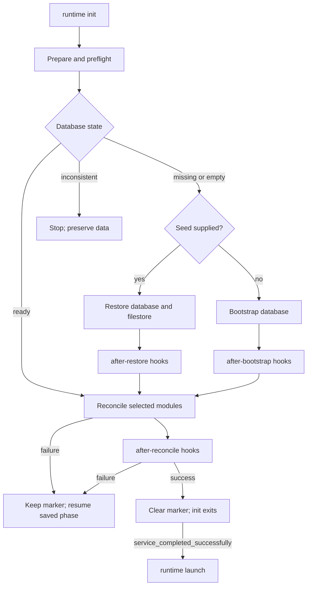
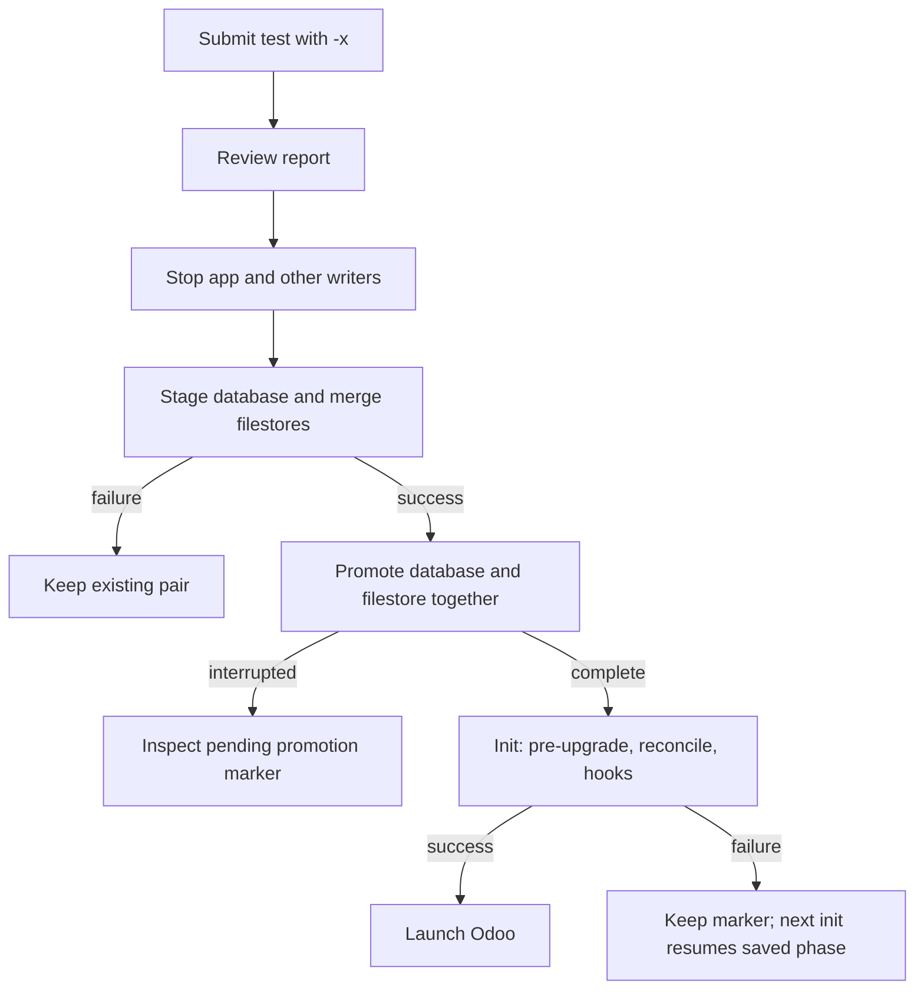

# Runtime lifecycle

A runtime is one PostgreSQL database and its matching filestore. Stop ordinary Odoo writers before initialization,
restore, clone, or replacement; gOdoo locks coordinate gOdoo operations only.

- Configuration precedence: CLI, exported environment, project `.env`. A Compose database target remains the target.
- `runtime init` prepares and reconciles once, then exits. `runtime launch` starts Odoo after init succeeds.
- Seed archives apply only to missing or empty databases.
- A missing or empty database with a nonempty filestore is inconsistent and needs matching-pair recovery.



## Initialize and launch

```bash
# Run against the downstream project's configured database.
godoo runtime init \
  && godoo runtime launch
```

### Fixed runtime datasets

Set `GODOO_DUMP_PATH` or pass `--dump-path` to a mounted dataset directory. The directory contains `odoo.dump` and the
original source filestore at `odoo_filestore/filestore/odoo`. Init restores that plain pair into the configured runtime
database.

With `--migration-dir`, init instead selects `upgraded.zip` from the same directory and overlays it on the original
filestore. `--seed` remains authoritative; when it selects that paired `upgraded.zip`, init infers the original
filestore unless `--original-filestore` names one explicitly. Invalid dumps, ZIPs, or required filestores fail before
init changes the database or filestore.

```bash
godoo runtime init --dump-path /restore/dataset
godoo runtime init --dump-path /restore/dataset --migration-dir migrations/16-19
```

- Launch checks the Odoo version, pending recovery, and process dependencies before starting the server.
- If `ODOO_BANNER_TEXT` or `ODOO_BANNER_BG_COLOR` is non-empty, launch applies the bundled banner script first, in
  either runtime mode. Unset or blank banner settings skip this update. A failed update prevents server startup.
- Runtime commands require Odoo 16 or newer. Archive commands default to native Odoo commands on 19 or newer and
  PostgreSQL tools on 16–18; restore options may require SQL staging. Archive validation reports bytes checked, with
  updates at most every five seconds plus final measurements. Phases without measured progress report elapsed time every
  ten seconds. Linux restores try filesystem cloning first; when cloning is unavailable, rsync writes its progress and
  diagnostics directly to stdout when present, otherwise the existing Python copy fallback reports elapsed phases. SQL
  staging sends native `pv` progress to stderr when present and reports bytes sent otherwise. SQL restore discards
  query-result tables while keeping PostgreSQL diagnostics on stderr. Input reaching 100% means the dump has been sent;
  PostgreSQL may still be working. The original-filestore copy and database restore report start and completion or
  failure.
- `runtime status` is read-only. `runtime shell` and `runtime shell-script` start explicit Odoo shell sessions.
- `--update` and `--install` select module reconciliation. `--report-url` or `GODOO_REPORT_URL` sets Odoo's `report.url`
  after successful init; it is required when `--x-sendfile` or `GODOO_X_SENDFILE` is enabled.
- Hook directories run in configured order; each directory's `*.py` files run lexically, one Odoo shell session per
  file. Phases are at-least-once, so scripts must be safe to rerun. Contents may change at a selected path.

Dependency installation, custom dump checks and restores, strict filestore clones, and the official upgrade client
report elapsed time every ten seconds. Child output, including interactive shells and the running Odoo server, keeps its
native streams.

## Migration directories

Run init from the downstream workspace root to select a transition directory:

```bash
godoo runtime init --migration-dir migration/transitions/16-19 \
  --seed /restore/upgraded.zip --original-filestore /restore/original-filestore
```

`GODOO_MIGRATION_DIR` is the environment fallback. Relative directories resolve from the current working directory;
absolute mounted directories work too. The basename must be an increasing version pair such as `16-19`. Init derives the
target major and checks the configured Odoo runtime before changing configuration, database, or filestore state. A
matching `--expected-odoo-major` is allowed; a different major is rejected.

The directory must contain `pre-upgrade.py` and at least one direct `after-reconcile/*.py` file. Init requires an
explicit native seed ZIP and a nonempty original filestore directory. Demo data cannot be combined with a migration.

Directory names and files, module lists, hook entrypoints, selected roots, seed and filestore inputs, the configured
runtime target, and dependencies known before restore are checked before mutation. Init checks dependencies again after
restoring the seed, when restored database state may reveal additional requirements. If that check fails, the restore
has already completed and the existing bound plan remains pending at `after-restore`. Fix the dependency and retry the
same inputs; init resumes that phase.

| Transition input               | Init behavior                                                                                    |
| ------------------------------ | ------------------------------------------------------------------------------------------------ |
| Missing `update_modules.txt`   | Update `all`.                                                                                    |
| Empty `update_modules.txt`     | Skip native updates, pre-upgrade scripts, and upgrade roots; installs and final hooks still run. |
| Nonempty `update_modules.txt`  | Update the listed modules.                                                                       |
| Optional `install_modules.txt` | Install the listed modules.                                                                      |

Module files accept one module per line and comma-separated values; whitespace and duplicates are removed. Upgrade roots
run in this order: workspace `migration/upgrade` if present, transition `upgrades` if present, then explicit
`--upgrade-path` additions. Selected roots must exist. Transition final hooks run first, followed by explicit
`--after-reconcile-dir` additions. Each directory's Python files run lexically through the existing hook runner.

Generic `--update`, `--install`, `--pre-upgrade-script`, `--after-bootstrap-dir`, and `--after-restore-dir` options
cannot be combined with migration selection. Unset `GODOO_RECONCILE_UPDATE`, `GODOO_RECONCILE_INSTALL`,
`GODOO_RECONCILE_PRE_UPGRADE_SCRIPTS`, `GODOO_RECONCILE_UPGRADE_PATH`, and the `GODOO_AFTER_*_DIRS` phase defaults;
nonempty values are rejected even when a CLI option would override them. Use explicit CLI options for additional upgrade
roots and final project hooks.

The existing pending plan binds the selected directory, target, module lists, roots, pre-upgrade script, and hook
entrypoints, including inputs skipped by an empty update list. Resume the same selection after a failure. Script
contents retain the existing at-least-once retry policy. Ordinary init without a migration directory keeps its direct
flags and environment defaults.

An already bound pending plan started with direct init flags must be resumed with those original flags before switching
to migration-directory selection.

## Official and major-version upgrades

`godoo upgrade` fetches Odoo's official client and forwards its arguments.

- Operations: `test`, `production`, `restore`, `status`, `log`, and `wipe`.
- Pass `-x` to suppress the official client's local restore of a test result. Review the report before restore.
- Use `production` only when the upgrade is ready.

```bash
# Submit for testing; -x keeps the result out of the local runtime.
godoo upgrade test -i ORIGINAL_DUMP -t 19.0 -c CONTRACT -x
```

- `--original-filestore` must name the source database directory, such as `ODOO_DUMP_VARLIB_FOLDER/filestore/SOURCE_DB`;
  do not pass its parent or another nested `filestore/<database>` path.
- gOdoo copies original files to staging, then overlays archive files. Original-only files remain; ZIP files replace
  collisions. Staged files are independent regular files, using filesystem cloning when available and copy otherwise.
- Archive and source-tree checks happen before database mutation. Without this option, normal ZIP restore behavior is
  unchanged.

The option or `GODOO_ORIGINAL_FILESTORE` works with `godoo db load`, `godoo db prepare`, and
`godoo runtime init --seed`.

An initialized database from an older Odoo major fails the runtime-version guard before preparation or reconciliation;
`--seed` cannot replace it. Stop the app and other database writers, then load the upgraded pair and initialize:

```bash
# Stop downstream app services and other database writers first.
godoo db load RESULT.zip --original-filestore /path/to/filestore/SOURCE_DB --force \
  && godoo runtime init --update your_modules --pre-upgrade-script /path/to/migrate.py \
  && godoo runtime launch
```

- `--pre-upgrade-script` runs before Odoo opens the registry and requires `--update`.
- With `--seed` and `--pre-upgrade-script`, do not set `--after-restore-dir`; that restore hook opens the registry
  first. Seeded pre-upgrade SQL staging works without an after-restore hook.
- `--upgrade-path` also requires `--update`. Keep the source dump and filestore for recovery; completed Odoo changes are
  not automatically rolled back.



## Status and recovery

`godoo runtime status --json` is read-only and returns:

| State          | Exit code |
| -------------- | --------: |
| `ready`        |         0 |
| `missing`      |        20 |
| `empty`        |        21 |
| `inconsistent` |        22 |
| `unavailable`  |         1 |

Status reads production provenance from `/odoo/godoo-source-provenance.json`; `--provenance-path` overrides it. Missing
provenance does not establish release identity. It does not write runtime state or inspect host source roots.

### Locks

- Every container managing a runtime must share its data volume at the same `data_dir`.
- Locks under `<data_dir>/.godoo/locks/` coordinate gOdoo only; ordinary Odoo writes do not take them.
- Clones lock source and target in order; nested restore calls reuse held locks.
- Lock files remain after release; do not remove them while a process may wait.

### Pending initialization

- `.godoo/pending-lifecycle/` records the target, modules, ordered addon paths, artifact identities, upgrade roots, and
  hook entrypoints. A changed selected archive stops init before callbacks.
- Plan identity does not prove database origin or detect edits inside nested filestore files.
- Bound markers without addon paths fail the plan check.
- Only schema-one markers may use `--adopt-pending-plan`, after recovery inputs are checked. Adoption preserves the
  phase, has no environment fallback, and cannot rewrite a bound plan.
- `db prepare` tries CoW clone, PostgreSQL restore, native Odoo restore, then bootstrap; `--strategy` can require one.
- Its schema-three handoff records input identities, strategy, outcome, and pending phase. Resume incomplete preparation
  with the same inputs.
- A completed handoff binds to init after target checks; the original inputs are no longer needed.

### Interrupted restore

- SQL errors leave the previous database and filestore in place.
- Promotion retains the old database until the filestore swap succeeds and rolls back a failed swap.
- `.godoo/pending-restores/` marks promotion. After interruption, status reports `inconsistent` and init refuses to
  guess.
- Inspect the database, filestore, backups, and marker before recovery; do not delete the marker to clear the state.
- Init clears lifecycle state only after preflight, reconciliation, and hooks succeed.

- gOdoo forwards SIGINT and SIGTERM to child processes, waits for shutdown, and preserves their exit status.

Use `godoo runtime --help` and `godoo db --help` for current commands. See [downstream runtime setup](downstream.md) for
the service contract.
