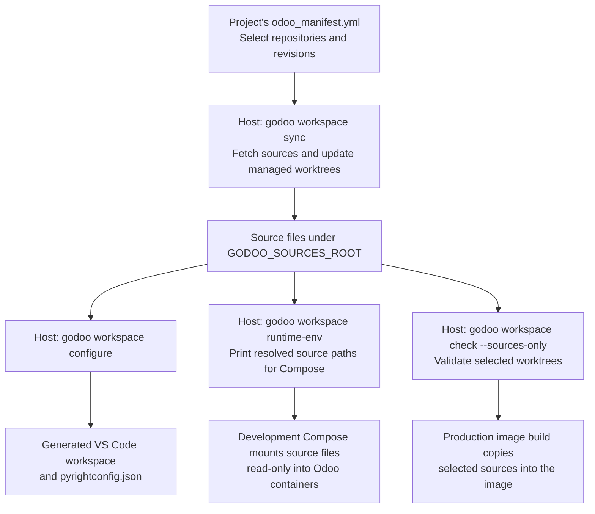

# Source workspaces

[Documentation](../README.md#documentation) · [Architecture](architecture.md) · [Downstream setup](downstream.md)

Use workspace commands on the host, from the downstream project directory. The project's `odoo_manifest.yml` selects
Odoo and third-party repositories; `GODOO_SOURCES_ROOT` stores their managed sources outside the project.

## Configure and synchronize

```bash
# Run from your project; its .env and manifest supply the configuration.
cd /path/to/project

# Use an absolute shared-source directory outside the project.
# Set this in .env instead if each shell should inherit the same value.
export GODOO_SOURCES_ROOT=/absolute/path/to/shared-sources

# Synchronize managed sources. This can discard edits in verified worktrees.
godoo workspace sync

# Generate editor files from the selected sources.
godoo workspace configure

# Validate offline without changing worktrees.
godoo workspace check
```

CLI values take precedence over exported environment values, then the project `.env`. `ODOO_MANIFEST` defaults to
`odoo_manifest.yml` in the project directory. The manifest must declare `odoo`.

```yaml
# odoo_manifest.yml — a minimal source selection.
odoo:
  url: https://github.com/odoo/odoo
  branch: "19.0" # Required for Odoo.

thirdparty:
  OCA:
    - url: https://github.com/OCA/server-tools
      branch: "19.0" # Select the intended Odoo series.
      # Add commit: <full-sha> to pin an exact revision.
```

See [the repository manifest](../odoo_manifest.yml) for Enterprise access, commit pins, shallow history, and merge
recipes. A floating branch can advance on sync; use a commit pin when the source revision must stay fixed.

## Source-to-runtime flow

After synchronization, the same selected sources feed three independent tasks: editor setup, development mounts, and
production image builds. The arrows show which inputs each task consumes.



| Command                 | Changes state? | Purpose                                                                    |
| ----------------------- | -------------- | -------------------------------------------------------------------------- |
| `workspace sync`        | Yes            | Update managed worktrees and archive caches; may reset verified worktrees. |
| `workspace configure`   | Yes            | Validate sources and generate editor files under `.godoo/workspace.lock`.  |
| `workspace check`       | No             | Validate offline, without source-worktree or archive locks.                |
| `workspace runtime-env` | No             | Validate sources and emit shell-safe resolved path assignments.            |
| `workspace materialize` | Yes            | Copy selected sources into an image layout.                                |
| `workspace storage`     | No             | Inspect shared source storage.                                             |
| `workspace gc`          | Yes            | Manage shared storage cleanup; inspect `--help` before use.                |

Git fetches report elapsed time every ten seconds and retain Git output for failure diagnostics. Git owns the pools,
worktrees, branches, locks, and caches under the shared source root; use workspace commands to manage them.

## Editor configuration

For development of gOdoo itself:

```bash
# Install the versions used by both pre-commit and VS Code.
uv sync --locked
npm ci

# Regenerate editor state before running the type checker.
make workspace
make typecheck
```

Open `godoo.code-workspace` for this repository, or the generated `<project>.code-workspace` downstream. Opening the
same files in another project's window does not load their workspace settings.

| Generated setting    | Contract                                                                                                   |
| -------------------- | ---------------------------------------------------------------------------------------------------------- |
| Workspace folder     | Fixed name `gOdoo`; project-relative paths use `${workspaceFolder:gOdoo}`.                                 |
| Selected sources     | Odoo, addon, and archive paths remain absolute host paths.                                                 |
| Python analysis      | The Python extension's language server is disabled so Odoo IDE can provide Python and Odoo analysis.       |
| Python extension     | Keep it installed for interpreter selection and debugging.                                                 |
| Extra paths          | `python.analysis.extraPaths` includes the selected sources.                                                |
| `gOdoo: attach`      | Maps the project to `/odoo/godoo_workspace` and the selected sources to their development-container paths. |
| `pyrightconfig.json` | Ignored project-root file covering `src/`, `addons/`, `scripts/`, project addons, and resolved sources.    |

Python uses Ruff for formatting and safe fixes on save, with lint rules from `pyproject.toml`, including C901. Supported
text formats use Prettier and `.prettierrc.yml`.

`make typecheck` requires the generated configuration and runs
`.venv/bin/pyright --pythonpath .venv/bin/python --project pyrightconfig.json`. `make configure` remains an alias for
`make workspace`.

## Generated files and downstream handoff

Configure removes the retired `.godoo/docker-compose.sources.yml` and `.godoo/source-provenance.json` when they are
regular files. Check fails while either remains. Regenerate managed files rather than editing them by hand.

Downstream Compose owns bind mounts and services. Development mounts the source root read-only at its resolved host
path. Production checks sources on the host and materializes selected files from a read-only BuildKit context. Start the
downstream debug service before using the attach configuration. See [downstream runtime setup](downstream.md) for
mounts, image builds, and service ordering.
